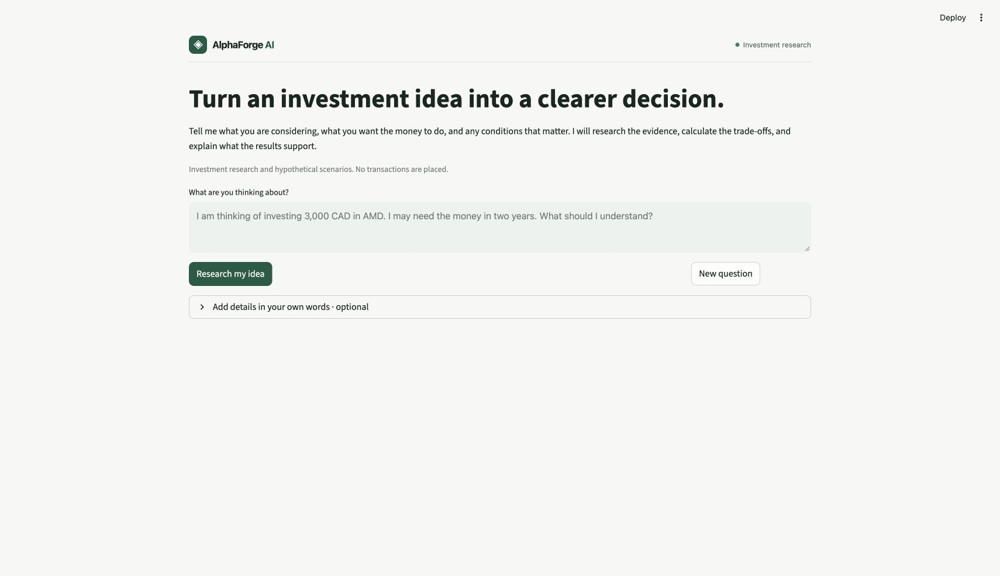

# AlphaForge AI

### An investment idea, examined with evidence

**PolyFinances Datathon 2026 · Banque Nationale · AWS**

Describe what you are considering and what matters to you. AlphaForge turns that question into an analysis plan, retrieves dated public observations, calculates the evidence in Python, and presents a conclusion with supporting evidence, counterevidence, charts and important gaps.

The customer interface starts with a single question. There are no preset question buttons, professional workflow choices or developer validation navigation. Optional details and later corrections become analysis context. The official investor personas are used only as test fixtures.

[Quick start](#quick-start) · [Technical guide](submission/technical-summary.md) · [One-page summary](submission/one-pager.pdf) · [Validation](submission/final-verification.md) · [All deliverables](submission/README.md)



## How it works

1. **Understand the question.** Retain stated goals, amounts, horizons, cash needs, holdings and constraints. Missing information remains unknown.
2. **Plan the analysis.** Propose questions and select the tools needed to answer them.
3. **Collect and calculate evidence.** Retrieve observations, run Python calculations and verify numerical results. Keep source dates and scope limitations.
4. **Synthesize an answer.** Weigh supporting and opposing evidence. Request additional analysis when a gap can be resolved within the available tools and budget.
5. **Review the conclusion.** A separate model call checks claims, citations, material context and unresolved tasks. Failed review can trigger repair; unsupported prose is withheld.

The conclusion appears before supporting tables and charts. Download the report as standalone HTML with charts or Markdown. The assistant does not place trades.

For example: `I am considering investing 3000 CAD in AMD. I may need the money in two years. What should I understand?` Add a relevant condition or correct an earlier statement using the follow-up field. A changed condition should affect the analysis when justified by evidence; a changed name should not.

## Quick start

Use **Python 3.10 or later**; recorded local validation uses Python 3.10. Access to this private repository is required.

```bash
git clone --branch architecture-completion-20261115 https://github.com/foglands/datathon.git
cd datathon
python3 -m venv .venv
source .venv/bin/activate
python -m pip install -r requirements.txt
python -m streamlit run app.py
```

On Windows PowerShell, activate with `.venv\Scripts\Activate.ps1`. Open the URL printed by Streamlit, normally `http://localhost:8501`.

**For model-led research**, launch Streamlit from a shell with a valid AWS session and access to the configured Amazon Bedrock model. Credentials set in another terminal are not inherited by an already running app. Use the normal AWS credential provider chain; do not put credentials in repository files.

```bash
export DATATHON_AWS_REGION=us-east-1
export DATATHON_PROFILE_MODEL_ID=global.anthropic.claude-sonnet-4-5-20250929-v1:0
python -m streamlit run app.py
```

The customer route can retrieve public prices and FX without the organizer archive. The full reasoning workflow needs a valid Bedrock session. Without it, supported local interpretation/calculations may remain available, but the app reports limited or unavailable research rather than claiming a reviewed model conclusion. Offline historical validation is available separately.

See [setup and troubleshooting](docs/RUNNING.md) for organizer data, environment settings, AWS diagnostics and CLI reproduction.

## Evidence and supported scope

| Capability | Current boundary |
| --- | --- |
| Public asset research | Up to three requested instruments; Yahoo Finance's unofficial chart interface; up to five years of daily adjusted observations; ambiguous listings need clarification |
| Historical risk | Return/loss, drawdown, volatility, rolling outcomes, recovery and selected stress replays; history is not a forecast |
| Currency and purchasing power | CAD/USD conversion using Bank of Canada FX; Canadian CPI where relevant and available; distinct observation periods |
| Portfolio and withdrawals | Complete explicitly stated weights; single or fixed monthly withdrawal schedules with sufficient inputs; no inferred holdings or success probability |
| Bond and exposure evidence | Dated AGG duration/credit extract and qualified issuer/sector evidence; limited coverage and unknown weights remain explicit |
| Follow-up and review | Sourced corrections/retractions, bounded extra tool calls, claim/task review, visible partial and evidence-only outcomes |

Quotes may be delayed. Public research is a current retrospective, not a historical-vintage backtest or execution feed. Fundamentals, valuation, news, complete fund look-through and comprehensive ESG screening are not supplied. A traded-volume ratio does not prove execution feasibility. VaR/ES are withheld without certified observation coverage. See [sources and method boundaries](CUSTOMER_RESEARCH.md).

## Validation status

The latest full-data regression result and commands are in [final verification](submission/final-verification.md). Tests cover calculations, evidence provenance, task contracts, conversation state, authorization, tampering and Streamlit behavior.

**Model generalization remains partial.** Frozen-data trials exposed paraphrase/irrelevant-detail inconsistencies and semantic-review false positives. Failures are retained in the [analysis reliability record](submission/analysis-validation-2209.md) and [reasoning evaluation](submission/reasoning-validation.md). Unit-test success or model approval does not establish universal answer quality or investment suitability.

```bash
python -m unittest discover -s tests -q
```

Without the organizer archive, data-dependent tests skip. Set both starter-path variables for complete coverage; see [RUNNING.md](docs/RUNNING.md). GitHub Actions runs the credential-free suite without Bedrock calls or bundled organizer data.

## Historical reference workbench

A separate developer app, `python -m streamlit run validation_app.py`, preserves Compare, Evaluate and Audit, fictional personas, controlled funding searches and acceptance tools. Reference cases are absent from the customer interface. Original-proposal review never authorizes an alternative search. See [workbench methods](docs/historical-workbench.md) and [CLI examples](docs/RUNNING.md#historical-workbench-and-cli).

## Repository map

| Location | Purpose |
| --- | --- |
| `app.py`, `datathon/customer_view.py` | Customer application and conversation |
| `validation_app.py` | Separate developer workbench and reference cases |
| `customer_agents.py`, `customer_state.py`, `customer_profile.py` | Grounded intake, sourced state changes and relevant context |
| `inquiry_engine.py`, `inquiry_contracts.py`, `customer_tools.py` | Analysis tasks, bounded investigation, synthesis and claim/task review |
| `customer_data.py`, `customer_risks.py`, `customer_bonds.py` | Public observations and calculation tools |
| `customer_workflow.py`, `customer_report.py` | Orchestration, report binding and exports |
| `datathon/decision_*.py` | Historical confirmation, replay, evidence, review and funding machinery |
| `tests/`, `examples/`, `presets/` | Regression suite and fictional validation inputs |
| `docs/`, `submission/` | Running guide, technical documents, PDFs, screenshots and dated validation |

Module names without a directory prefix are under `datathon/`.

## AWS, data and license

Amazon Bedrock performs question understanding, planning, synthesis and separate semantic review through Strands tool handoffs. Python remains the authority for numerical results. Optional versioned S3 export exists in the historical workbench. Knowledge Bases, managed Guardrails, Step Functions and Object Lock are not claimed deployed services.

Use fictional inputs for demonstration. Raw downloaded prices, the organizer archive, credentials and private account data are not bundled. Source terms remain applicable; the [MIT license](LICENSE) covers project code, not third-party data redistribution rights.

[Contributing](CONTRIBUTING.md) · [Changelog](CHANGELOG.md) · [Requirements](ANALYSIS_REQUIREMENTS_2209.md) · [Submission index](submission/README.md)
