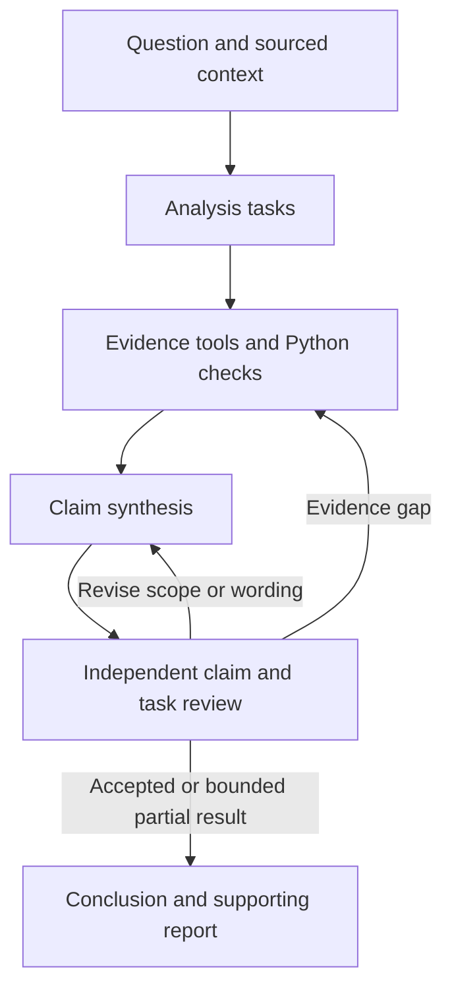

# AlphaForge AI
## Technical documentation

**PolyFinances Datathon 2026 · Team 38 · November 16, 2026**

**Team members · Peng Peng, Shaoze Ying, Xuhan Liu**

AlphaForge is a conversational investment-research prototype. A user describes an idea and relevant conditions. The system plans the inquiry, searches for public sources, runs Python calculations on qualified data and reviews the claims. This guide covers the customer route. The [historical workbench](../docs/historical-workbench.md) supports reproducible reference audits.

## 1. Customer experience and scope

Run `app.py` for the customer interface with one question field, optional context and follow-up conversation. Three optional examples adapt the official case brief (pp. 5–7): diversification with AI and Bitcoin, growth and stability with ESG preferences, and stock risk before retirement. **Apply question** fills editable text, and **Analyze my question** submits it. All questions use the same workflow. The separate `validation_app.py` retains developer workflows and formal persona fixtures.

The report leads with a scoped conclusion when review supports one. Supporting evidence, counterevidence, tasks, sources and open questions follow. Downloadable HTML includes vector charts when qualified prices are available. Markdown provides a text version. When review withholds a conclusion, the report retains the checked observations.

Profiles supply context, not verdicts. Goals, willingness, loss capacity, withdrawal needs, holdings and explicit rules are separate facts. Names, ages and the official personas do not supply default thresholds. Changing context may change the investigation or interpretation; identical numerical inputs must preserve their calculations.

## 2. Architecture and actual model roles

| Stage | Responsibility | Main modules |
| --- | --- | --- |
| Understanding | Extract source-linked instruments and statements; preserve corrections, retractions, conflicts and unknowns | customer_agents, customer_state, customer_profile |
| Planning | Propose up to four analytical tasks with required outputs and observable completion conditions. Select up to two live research topics | inquiry_engine, inquiry_contracts |
| Execution | Run AgentCore search, resolve listings, retrieve qualified observations and check Python calculations | web_research, customer_data, customer_tools, customer_risks, customer_bonds |
| Synthesis | Produce checkable claims; request additional feasible evidence; distinguish asset, product and portfolio scope | inquiry_engine |
| Review | Check claim support, material context, task completion, scope and counterevidence; request repair or narrow the answer | inquiry_engine |
| Publication | Preserve provenance, review results and content fingerprint in the displayed/exported report | customer_workflow, customer_report, customer_ui |

Amazon Bedrock through Strands supplies the language-model calls. Intake, planner, analyst and reviewer use the configured profile model; the default is `global.anthropic.claude-sonnet-4-5-20250929-v1:0` in `us-east-1`. The reviewer is a separate invocation with its own contract, not an independently trained model. Semantic review can be wrong; Python calculation checks are a different control.

A model may call catalog tools, not execute arbitrary Python or invent a provider. A successful call does not by itself complete a task. Required outputs are compared with actual measures and supported scope. Missing portfolio weights cannot be replaced with a single stock's history and called portfolio analysis.

## 3. Evidence and calculation contracts

Each substantive claim has evidence/context references, scope, assumptions and limitations. Numeric literals must match cited Python evidence or literal user-stated inputs. An investment budget, future target and withdrawal amount are distinct fields. Citation and exact-value checks establish origin, not semantic entailment; the independent review checks meaning but is fallible.

The workflow can retrieve additional evidence after an analyst request or review rejection. If no feasible tool can close a gap, it narrows scope, asks a focused question or retains a partial result. It does not force a short-horizon refusal, a risk-label conclusion or a largest-risk ranking.

Conversation changes are source-linked. Exact repetitions of active facts retain their earlier provenance; new or changed facts require quotations from the current message. Corrections replace the identified fact, and retractions keep the field unknown. User and provider text are treated as evidence, not authority to change tool contracts.

The shared default inquiry budget is 240 seconds, 10 model-role calls, 8 tool calls and 12 source calls. It permits up to three investigation rounds, two format repairs and two review attempts, subject to remaining budget. Inquiry-stage calls are capped at 80 seconds within the remaining time. These are stopping rules, not guaranteed response times. Usage records observed calls/tokens; no dollar cost is inferred.

## 4. Data sources and qualification

Live discovery starts from the instrument identifiers and the planner's topic. Supported topics cover adjusted daily prices, fund methodology and issuer filings. The app sends the public instrument names and fixed topic wording to AgentCore. The evidence tab displays the query, timestamp, links and lookup status. An issuer-filing task can check the ticker, SEC filing identifier and filing date directly against SEC EDGAR. The report treats search excerpts as leads and keeps them out of numerical evidence. Daily metrics require an eligible series with dates, listing currency and documented adjustment basis. The price archive is optional for discovery.

| Source | Treatment | Boundary |
| --- | --- | --- |
| AgentCore Web Search | Request-time public source discovery. Captures links, search time and lookup status | Search excerpts establish leads. Daily figures require qualified observations |
| Organizer starter archive (first source) | Historical `adj_close` in listing currency, raw `close` for indicative share sizing, same-date Bank of Canada USD/CAD fixings, price CSV SHA-256 and dated observations retained with the asset; `StarterResearch` in `customer_data.py` | 31 instruments, 2021-11-12 to 2026-11-12; frozen, not a live quote; CPI is not in the price archive |
| Private S3 price snapshot | Optional approved ZIP with a pinned SHA-256 digest and source metadata | Requires permission to use the data and read access to the named S3 object |
| Yahoo Finance chart/search | Optional external adapter for daily prices | Disabled by default. Enable only with authorization for automated access and intended use |
| SEC EDGAR and issuer disclosures | Can check filing metadata. Dated extracts cover SPY holdings, IBIT's objective, ESG methodology, annual fund returns and TSLA price observations | Metadata verifies filing identity and date. Dated extracts support the specific periods and claims shown |
| Bank of Canada Valet | FXUSDCAD, expressed as CAD per USD; compatible dates for historical conversion | FX and equity observations need not be simultaneous for latest-price sizing |
| Canadian CPI via Bank of Canada | Statistics Canada all-items Canada series V41690973; align month-end observed prices to CPI reference months | Latest vintage, not point-in-time releases or forecast inflation |
| Bond disclosure catalog | Dated issuer extract with locators, observation/as-of dates and eligibility checks | Initial AGG coverage only; older than 31 days or observed after research date is rejected |
| Qualified issuer/sector and GPFG evidence | Dated classifications and exposure bounds; unknown weight retained | Partial look-through; a named controversy list is not a comprehensive ESG rating |
| Organizer starter archive (historical workbench) | Frozen CSV hashes, row references and date qualification in the deterministic replay, funding and challenge tools | Required for full reference replay; not redistributed |

Source URLs are retained in reports and catalogs. [CUSTOMER_RESEARCH.md](../CUSTOMER_RESEARCH.md), [DECISION_EVIDENCE.md](../DECISION_EVIDENCE.md) and [bond_disclosures.json](../datathon/bond_disclosures.json) give source-specific qualifications. Availability/publication, observation and retrieval dates are distinct. A currently retrieved adjusted series is retrospective evidence, not proof of what an investor knew on an earlier date.

Raw downloaded market arrays and the organizer archive are not committed. The repository license does not grant third-party redistribution rights.

## 5. Financial methods

For complete stated weights w and adjusted prices P in a common currency, buy-and-hold value is `V(t) = sum(w[i] * P[i,t] / P[i,0])`. Holdings drift; no daily rebalancing is assumed. Vendor adjustments are not applied twice. Price-based replay adds no taxes, execution costs or separate distribution cash-flow ledger.

Terminal return is the ending/start value ratio minus one; terminal loss is its nonnegative negative part. Maximum drawdown is the largest fall below an earlier peak. Separate computations verify the path and relevant metrics. Volatility uses daily sample standard deviation and a 252-session annualization convention. Rolling, calendar-month and recovery measures retain their actual windows and eligibility limits; insufficient history stays unavailable.

USD history is converted with same-date CAD-per-USD FX; CAD assets are not converted again. Return decomposition separates local price, FX and interaction. CPI-adjusted change uses the ratio of nominal growth to CPI growth over its own aligned interval, which may differ from the full price-history period.

Current whole-share sizing uses the latest observed price and separately dated FX, leaving a cash residual. Historical illustration instead invests the full amount in fractional units at the first observation. These are distinct conventions and neither is an order.

A fully specified single or fixed monthly withdrawal schedule can be replayed through observed history using fractional unit sales, funding shortfalls and remaining assets. Relative future timing is mapped to a historical path. This is not a future success probability; weekly, quarterly, variable and multiple simultaneous schedules remain unsupported.

Holding-period analysis uses the explicitly stated horizon and independently checks overlapping historical windows. It does not extrapolate a ten-year result from five years of data or treat overlapping outcomes as future probabilities.

Duration uses first-order negative duration times yield change with labeled system scenarios; it omits convexity, spread and FX responses. Credit buckets describe underlying holdings, not the ETF's credit rating or repayment guarantee. Transaction amount divided by recent observed traded value is a volume proxy only, not a measurement of spread, impact, depth or execution certainty.

## 5b. Deterministic historical engine and traceability

Underneath the conversational route, and exposed directly in the historical workbench, sits a deterministic engine (`datathon/decision_*.py`, with the original `finance.py`/`governance.py` reference pair) that does not depend on any model call:

- **Replay.** Buy-and-hold valuation in CAD on the frozen archive over the full shared history, the named 2022 and early-2025 stress windows, an optional 2023 window and user-specified intervals, each with its own calendar-coverage status.

- **Metrics.** Signed terminal return, nonnegative terminal loss, maximum drawdown with peak and trough dates, recovery time or unresolved time underwater, rolling 12/36-month outcomes, annualized volatility, worst complete month, per-asset drawdown contributions and FX decomposition.

- **Funding search.** One or more authorized source holdings, explicit ticker-weight bounds and terminal-loss, drawdown or rolling-loss caps solved as a linear feasibility problem with exact-rational certificates; infeasibility is returned with a certificate rather than a relaxed answer.

- **Independent review.** A second implementation rebuilds the CAD series from the raw CSV rows and recomputes every published figure; any mismatch blocks publication.

- **Challenge.** One changed assumption at a time, at most three rounds, stopping when the verdict changes, with the original report preserved.

**Traceability (reference audit).** Published historical metrics retain their rule and method versions, named replay window, aligned observation dates and source hashes. CAD values can be rebuilt from each instrument's `adj_close` row in `prices_daily.csv` and the same-date `usdcad` row in `fx_usdcad_daily.csv` for USD instruments. The independent implementation checks the rebuilt values before publication. Original-proposal results and separately authorized funding searches remain distinct; historical examples and commands are recorded in [verification.md](verification.md) and [historical-workbench.md](../docs/historical-workbench.md).

## 6. Publication, status and limitations

The report fingerprint binds its contents and is checked before display/export. Numerical verification does not prove data-provider accuracy, disclosure truth or investment suitability. Original-proposal audit and alternative-funding authorization are separate in the historical workbench; the customer route does not silently run a funding solver.

An observed breach of an explicit cap can be reported. A sample below the cap cannot certify a pass without the necessary coverage and confirmed scope. Incomplete holdings remain unknown exposure. VaR/Expected Shortfall are withheld without certified consecutive-session coverage. Fundamentals, valuation, news, complete ETF overlap and comprehensive ESG research are not provided.

A separate reviewer may reject valid conditional wording or miss an unsupported inference. Deterministic evidence-boundary checks catch specific failure patterns but cannot recognize every paraphrase. An answer marked reviewed is not a guarantee of correctness. Remaining tasks and restricted scope stay visible.

## 7. AWS, reproduction and validation

Bedrock Converse runs the intake, planner, analyst and reviewer. **Evidence & sources** displays the model, request region and observed roles after a successful call. AgentCore runs the selected live searches under the same AWS identity using `bedrock-agentcore:InvokeWebSearch` with `web-search.v1`. The report records search outcomes separately. Optional S3 reads can load an approved price snapshot pinned by SHA-256. Consult the [deployment guide](../docs/DEPLOYMENT.md#live-web-research) for IAM configuration and [AWS pricing](https://aws.amazon.com/bedrock/pricing/) for service-specific costs.

Open the [hosted app](https://alphaforge-datathon.streamlit.app/) or install `requirements.txt`, authenticate the application process and run `python -m streamlit run app.py`. For developer validation, run `python -m streamlit run validation_app.py`. Set both starter-path variables for full-data tests. See the [running guide](../docs/RUNNING.md) and [deployment guide](../docs/DEPLOYMENT.md) for AWS setup, reproduction and limitations.

The source-search revision passed 591 local regression tests with the organizer archive and passed GitHub Actions on both branches. The suite covers arithmetic, provenance, conversation state, authorization, publication and interface behavior. Live model trials also found paraphrase and irrelevant-detail inconsistencies and semantic-review false positives. Those outcomes inform how to interpret a reviewed answer.

## 8. Demonstration and observed results

| Case | Published evidence and decision relevance | Open question |
| --- | --- | --- |
| Tesla before retirement | The [SEC-filed price table](https://www.sec.gov/Archives/edgar/data/1114446/000111444623000724/tc8172999f_1fwp.htm) gives split-adjusted USD closes of 409.97 in Q4 2021 and 109.10 in Q4 2022. Python checks the 73.39% decline. The episode shows why loss magnitude matters near retirement | Complete adjusted daily history for maximum drawdown, recovery and rolling outcomes. Position size for impact on total savings |
| SPY, NVIDIA and Bitcoin | The dated SPY filing lists NVIDIA. The IBIT objective identifies Bitcoin exposure. A direct NVDA purchase adds exposure to an issuer already represented in the disclosed holdings | Current holdings and allocation weights for the combined diversification impact |
| ESGU and SPY | ESGU's published method describes activity and controversy screens. SPY's prospectus states its S&P 500 objective. Their reported calendar 2022 returns supply a narrow comparison | Verified daily risk comparison, dated holdings and issuer-level exclusions |

The TSLA online run returned live daily-price and issuer-filing links. A later public run of the company name with its ticker in parentheses also returned TSLA price-source links. Full-history metrics stayed open because the public run had no verified daily series. Local SEC EDGAR retrieval confirmed Tesla's October 22, 2026 Form 10-Q. The public report had yet to display that registry entry.

[Final verification](final-verification.md) records these runs. [Analysis reliability](analysis-validation-2209.md) retains live failures and same-data comparisons. [Historical verification](verification.md) describes earlier workbench revisions. The [demo script](demo-script.md) covers the current customer interface.

## 9. Next evaluation

Use untouched questions with independently labeled claim/task expectations, repeated runs and human review of both rejected and accepted answers. Measure invariance to names and irrelevant details, consistency under paraphrase, and justified sensitivity to material constraints. Broader data coverage should use the same explicit contracts; additional providers must not hide unsupported scope.
