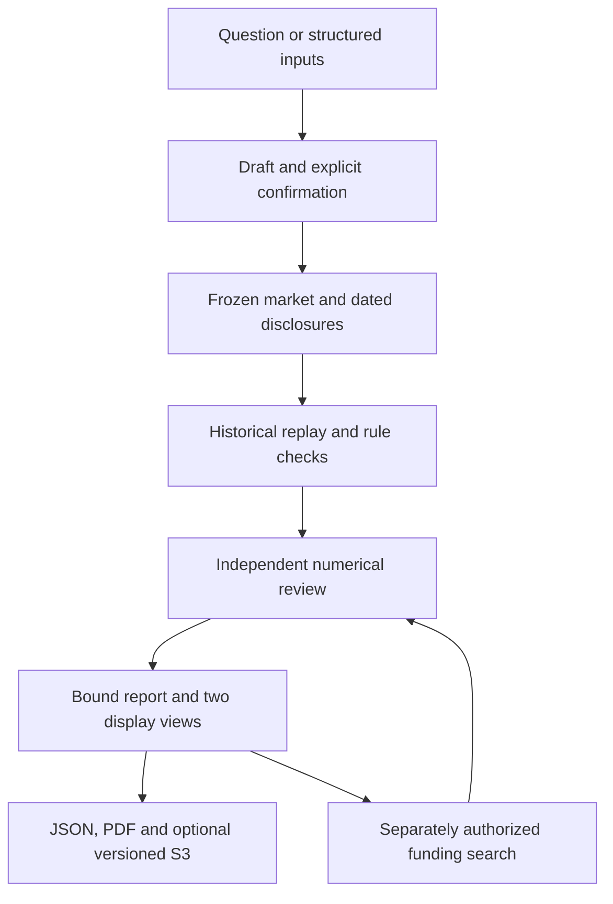

# AlphaForge AI · Technical documentation

PolyFinances Datathon 2026 · Banque Nationale × AWS

AlphaForge shows which of the user's confirmed rules a hypothetical investment decision meets, what caused a breach, and which evidence could change the conclusion. Historical results support self-assessment; the application neither executes orders nor predicts future performance.

## 1. Problem and implemented workflow

Buying the same asset can have different portfolio consequences depending on the holding sold, the investor's explicit limit, and the meaning of “loss.” A name or risk persona alone cannot determine those rules. AlphaForge separates profile context, proposed action, binding policy and evidence, then exposes the calculation and its review.

The general workspace has three actions: **Compare** two assets or allocations, **Evaluate** one allocation, and **Audit** a trade. Each uses an editable draft followed by explicit confirmation. An original-trade audit does not launch a funding search. The user separately specifies the permitted source holdings and smaller-size permission after seeing the original result.

The preserved reference workspace and CLI reproduce the earlier NVDA funding demonstration. Under **Reference cases → Earlier assistant validation**, the preserved assistant can retrieve read-only Alpaca observations; its current quotes are not fed into the frozen historical decision.

## 2. Models, tools and handoffs

| Decision or operation | Actual implementation | Boundary |
| --- | --- | --- |
| Question understanding | Sonnet through Strands/Bedrock proposes an intent and structured fields linked to original-language excerpts | Python validates literal values and structure; the user confirms before calculation. Offline drafts are explicitly labeled and have narrower language coverage. |
| Evidence qualification | Python checks dates, source metadata, classifications and interval evidence | No claim of a general model choosing among arbitrary financial documents |
| Replay, exposure and funding | Versioned Python functions compute metrics, bounds and certificates | The model cannot supply a financial value or change a confirmed threshold |
| Independent review | Separate calculation procedures and certificate checks | Any failed numerical or version check withholds the affected publication |
| Explanation | Optional Bedrock call composes at most 120 words from one or two approved finding references | Every sentence must exactly match an approved sentence or fixed allowed transition; all sentences of each selected reference are required. Failed prose is withdrawn while the deterministic explanation remains |
| General follow-up challenge | Report-only explanations or a separately confirmed one-field change, bounded to three rounds | Each replay starts from the original inputs; a changed verdict stops the sequence. Changed policies require their own funding authorization. |
| Legacy delegated Review | Nova selects a supported one-assumption check or evidence request | Preserved reference workflow; do not imply this live evidence covers the new challenge selector |

The new workflow is not described as eight autonomous agents. Data loading, optimization and numerical verification are tools and controls. Existing staged reference runs record typed role handoffs and real Bedrock request IDs. Independent numerical review remains a Python authority in every execution mode.

## 3. Evidence and calculation methods

### Source ledger

| Source | Dates and transformation | Limitations and use |
| --- | --- | --- |
| Organizer `prices_daily.csv` | Dated adjusted closes; source-file hash and CSV row references retained | Back-adjusted retrieved snapshot, not a point-in-time historical vintage. Do not apply listed splits again. |
| Organizer `fx_usdcad_daily.csv` / Bank of Canada | Same-date USD/CAD multiplied into USD prices; CAD prices retained | Missing fixings reduce common dates. Price and FX availability dates are checked independently. |
| Organizer asset and source metadata | Asset classifications, source retrieval dates and provenance | A fund wrapper label does not establish underlying sector or issuer weights. Original reuse terms continue to apply. |
| SPY / QQQ SEC N-PORT | Holdings observed June 30, 2026; filed August 28, 2026 | NVIDIA common-equity fractions, not complete universal issuer coverage. Public filing content retains its source attribution. |
| Qualified issuer/sector disclosures | Observation date, publication date, denominator, taxonomy and source locator | Incomplete coverage becomes an interval. A mandate bound is not a holdings audit. Stale or conflicting records are excluded. |
| NBIM GPFG list | Dated named-company checks; exclusions distinguished from observation | A policy-specific list, not an ESG rating. Direct issuers have limited named coverage; ETF constituents remain incompletely screened. NBIM source terms do not grant unrestricted redistribution. |
| Supplementary prices | User-provided `ticker,date,adj_close,currency` CSV plus public URL and publication date | User-declared origin; hashed and validated through the same currency/date pipeline. Existing eligible organizer series are retained. |

The knowledge date excludes sources that were not yet available and observations after the cutoff. Its default is the latest required source-availability date. This intentionally differs from using the last price observation as proof that a subsequently retrieved adjusted series was already available. The named windows are retrospective simulations.

### Historical metrics

For starting weights w and adjusted CAD prices P, the buy-and-hold value path is `V(t) = sum(w[i] * P[i,t] / P[i,0])`. Positions drift with prices; there is no within-window rebalancing. Returns use the vendor-adjusted-close series, not a separately reconstructed distribution cash-flow ledger. The replay adds no transaction costs, tax, inflation adjustment or execution model. Terminal return is `V(end)/V(start)-1`; terminal loss is its negative part. Drawdown compares each value with the prior maximum, retaining the selected peak and trough dates.

Recovery records the calendar time from the selected maximum-drawdown peak until that peak value is recovered. An unrecovered path retains time underwater and an unresolved recovery value. Rolling 12/36-month returns use calendar anniversaries and the last eligible observation at or before the anniversary. Complete calendar-month changes omit a trailing partial month. Volatility uses the sample standard deviation of close-to-close returns multiplied by `sqrt(252)`; this is a stated convention, including for assets observed on a different trading calendar. Signed return and drawdown contributions reconcile with the portfolio result. FX decomposition retains the interaction between local price performance and currency movement.

Named stress-window percentile context compares the reset starting allocation with comparable rolling periods. It describes the available historical sample and does not estimate a future event probability. Short or incomplete histories leave unsupported measures unavailable.

Full shared history and custom windows can be calculated without claiming independent exchange-calendar coverage. Such windows are marked accordingly and cannot establish that a binding risk rule passed or support a confirmed ranking. Named archived windows use pinned coverage checks. Missing required sessions remain a reason to withhold a decision on that window.

### Rules and funding

A policy carries exposure selectors `{asset_set, min, max}`, risk limits `{metric, cap, windows}`, and an optional trade. Direct ticker bounds are exact. Issuer, sector, asset-class and exclusion-list rules use qualified exposure intervals: a lower bound above a maximum proves failure; a qualified upper bound below it can establish passage; overlapping uncertainty yields unknown. Profile context never silently creates a financial threshold. An unsupported binding condition is always unknown, even when its wording resembles an allowed label; user-provided portfolio labels cannot change the disposition. Disclosure-based, mandate-bounded and unassessed portfolio weights are recorded separately from the weighted interval width; one minus the interval width is not complete holdings coverage.

The general funding engine accepts an arbitrary named target and one or more authorized source holdings. It optimizes permitted purchase size with a two-phase simplex implemented using Python `Fraction` arithmetic. This is an exact-rational implementation, rather than the SciPy solver proposed in the target design. Maximum-drawdown and rolling-loss restrictions generate path constraints. The result includes a dual optimality or Farkas infeasibility certificate checked independently; the exported report retains the complete certificate and resolved risk limits so that verification can be repeated. Each reported source range is a marginal range at the funded size; combining all reported minima or maxima need not produce a feasible joint allocation.

Recovery-time search and exposure rules without verified solver coefficients are explicitly unassessed. The system does not remove them from the problem. An undecided smaller-size scope cannot publish an unauthorized smaller allocation. Exact-source and zero-purchase edge cases are tested separately.

### Recalculation and publication

Market review reconstructs CAD series from frozen source fields. The replay checker uses a separately implemented path calculation and metric traversal. An evidence-context digest rejects changed qualification records. Exposure products and sums receive an exact-rational numerical check; this does not independently establish the truth of a source disclosure. Funding certificates are verified without trusting the solver's claimed feasible value.

Confirmation is a detached immutable snapshot. Review binds input, rule, method and fact hashes. The published object is checked again before UI display and before JSON, PDF or S3 export; a changed binding blocks release. A valid breach is publishable; an unsupported or uncertain rule remains visible. Publication approval is not approval to invest.

### A result-to-row trace

Select a candidate's `max_drawdown` in the metric records. Its record contains the value, formula version, candidate and window, confirmed-policy identifier, input hash and source rows at the peak/trough dates. For each holding, follow the recorded CSV line and file hash to `adj_close`, its listing currency, and the same-date FX row where applicable. Rebuild the CAD prices, calculate the portfolio values at the cited dates, then reproduce `1 - V(trough)/V(peak)`. The independent reviewer also scans the full observed path to verify that this is the maximum, not merely a matching pair.

The source file SHA-256 proves which bytes were used; it does not prove provider data accuracy or permission to redistribute the file. Metric-reference coverage and remaining provenance gaps are tracked in the architecture-status document.

## 4. AWS contribution and reproducibility

Amazon Bedrock makes real decisions in model-assisted drafting, constrained narrative composition and the preserved delegated challenge. Strands supplies typed tool handoffs. Python checks their results and records request metadata. Offline calculations and simulated legacy role events are labeled distinctly.

Optional S3 persistence writes the unchanged reviewed JSON to an existing versioned bucket. The operation checks versioning and returns the object URI, ETag and version ID. Required permissions are `s3:GetBucketVersioning` on that bucket and `s3:PutObject` under the chosen report prefix, plus applicable key permissions if the bucket requires a customer-managed encryption key. The app does not create buckets or alter public-access settings. Bedrock inference permissions must match the configured models and inference profiles. Credentials stay in the local environment or normal AWS provider chain.

Knowledge Bases, managed Guardrails, CloudWatch custom metrics, Step Functions and Object Lock are target extensions, not claimed deployed services. Per-audit currency cost has not been established from current model pricing; recorded usage is token and call telemetry, not an invented billing estimate.

Install the pinned dependencies with Python 3.10+, set both starter-path variables, and start `python -m streamlit run app.py`. The README gives model and optional S3 settings. Run `python -m unittest discover -s tests -q` with the complete starter archive. Tests with skipped data-dependent cases do not constitute full-data validation.

## 5. Validation, value and remaining work

The earlier `298e9b0` acceptance record reports 319/319 tests on local macOS and competition CloudShell, six live CLI cases, live UI checks, 36 expected scripted-fault outcomes and 16 runtime audits. Those observations belong to that revision. The older demo MP4 belongs to `13ccc42`. Current remediation results must be recorded separately in [verification.md](verification.md).

| Control removed | Consequence demonstrated by the test design |
| --- | --- |
| Source/value grounding | A quoted or invented number could become a policy without evidence |
| Separate search authorization | An original-proposal review could silently expand into another purchase |
| Independent arithmetic | Changed FX, drawdown or funding values could reach the result |
| Date and coverage checks | Future-source evidence or a missing trough could falsely settle a rule |
| Publication binding | A checked report could be edited after review and still exported |
| Unknown exposure | Missing holdings could be mistaken for zero issuer or controversy exposure |

The generic Robert CLI example reproduces a concrete boundary on the official archive. Selling 10 percentage points of ZST.TO to buy NVDA produces 16.15% terminal loss and 20.66% drawdown in the 2022 window; the original proposal breaches its 14% terminal-loss cap and 15% ZST.TO minimum. With separately authorized QQQ/ZST.TO funding and the same 10-point purchase, the certified QQQ-sale range is approximately 7.37–10.00 points. The selected all-QQQ funding example has 13.23% terminal loss in 2022 and 12.29% in early 2025. These are retrospective, CAD-denominated results, not future-loss estimates. The report preserves the original failure alongside the feasible funding result. A controlled follow-up can then vary only the risk definition. Mateo illustrates unresolved ETF screening, and Amira illustrates comparison without claiming complete diversification evidence.

This release does not claim unrestricted language understanding, complete ETF issuer/sector coverage, arbitrary binding-rule support, universal calendar verification, unrestricted free-form narrative verification, or measured external-user comprehension. No 100-prompt bilingual target benchmark or three-to-five-person comprehension study is claimed. The [architecture-status matrix](architecture-status.md) states the exact implemented and incomplete boundaries.

[Repository](https://github.com/foglands/datathon) · [README](../README.md) · [Verification](verification.md) · [Source qualifications](../DECISION_EVIDENCE.md) · [Sector evidence](../SECTOR_EVIDENCE.md)
