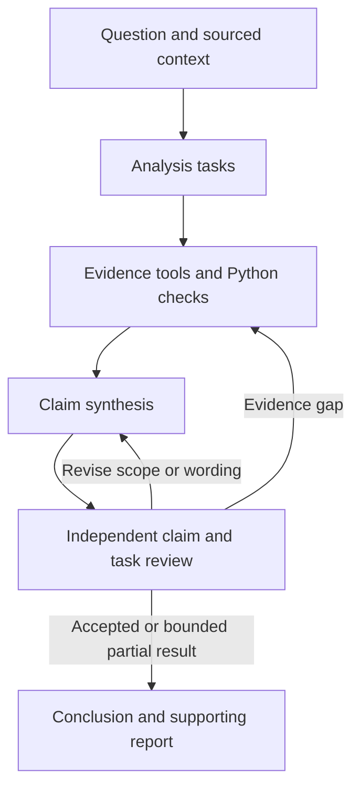

# AlphaForge AI
## Technical documentation

PolyFinances Datathon 2026 | Banque Nationale and AWS | Finalization: November 16, 2026

AlphaForge is a conversational investment-research prototype. A user describes an idea and relevant conditions; the system plans an inquiry, collects public evidence, calculates results and produces a reviewed explanation. This document describes the current customer route. The [historical workbench](../docs/historical-workbench.md) is retained separately for development and reproducible reference audits.

## 1. Customer experience and scope

Run `app.py` for the customer interface: one question field, a research action, optional free-text context and follow-up conversation. It exposes no persona buttons, professional mode selector or Reference cases navigation. The separate `validation_app.py` is for developers.

The report begins with the conclusion, then supporting evidence, counterevidence and important gaps. Context, task status, figures, sources and traces are available below. Downloadable HTML includes vector charts; Markdown provides a text version. A partial result is labeled partial. When review fails, checked evidence remains available without a fabricated personalized conclusion.

Profiles supply context, not verdicts. Goals, willingness, loss capacity, withdrawal needs, holdings and explicit rules are separate facts. Names, ages and the official personas do not supply default thresholds. Changing context may change the investigation or interpretation; identical numerical inputs must preserve their calculations.

## 2. Architecture and actual model roles

| Stage | Responsibility | Main modules |
| --- | --- | --- |
| Understanding | Extract source-linked instruments and statements; preserve corrections, retractions, conflicts and unknowns | customer_agents, customer_state, customer_profile |
| Planning | Propose up to four relevant tasks with inputs, measures, scope and observable completion conditions | inquiry_engine, inquiry_contracts |
| Execution | Resolve listings, retrieve dated observations and run selected calculations with numerical checks | customer_data, customer_tools, customer_risks, customer_bonds |
| Synthesis | Produce checkable claims; request additional feasible evidence; distinguish asset, product and portfolio scope | inquiry_engine |
| Review | Check claim support, material context, task completion, scope and counterevidence; request repair or narrow the answer | inquiry_engine |
| Publication | Preserve provenance, review results and content fingerprint in the displayed/exported report | customer_workflow, customer_report, customer_view |

Amazon Bedrock through Strands supplies the language-model calls. Intake, planner, analyst and reviewer use the configured profile model; the default is `global.anthropic.claude-sonnet-4-5-20250929-v1:0` in `us-east-1`. The reviewer is a separate invocation with its own contract, not an independently trained model. Semantic review can be wrong; Python calculation checks are a different control.

A model may call catalog tools, not execute arbitrary Python or invent a provider. A successful call does not by itself complete a task. Required outputs are compared with actual measures and supported scope. Missing portfolio weights cannot be replaced with a single stock's history and called portfolio analysis.

## 3. Evidence and calculation contracts

Each substantive claim has evidence/context references, scope, assumptions and limitations. Numeric literals must match cited Python evidence or literal user-stated inputs. An investment budget, future target and withdrawal amount are distinct fields. Citation and exact-value checks establish origin, not semantic entailment; the independent review checks meaning but is fallible.

The workflow can retrieve additional evidence after an analyst request or review rejection. If no feasible tool can close a gap, it narrows scope, asks a focused question or retains a partial result. It does not force a short-horizon refusal, a risk-label conclusion or a largest-risk ranking.

Conversation changes are source-linked. Exact repetitions of active facts retain their earlier provenance; new or changed facts require quotations from the current message. Corrections replace the identified fact, and retractions keep the field unknown. User and provider text are treated as evidence, not authority to change tool contracts.

The shared default inquiry budget is 240 seconds, 10 model-role calls, 8 tool calls and 12 source calls. It permits up to three investigation rounds, two format repairs and two review attempts, subject to remaining budget. Inquiry-stage calls are capped at 80 seconds within the remaining time. These are stopping rules, not guaranteed response times. Usage records observed calls/tokens; no dollar cost is inferred.

## 4. Data sources and qualification

| Source | Treatment | Boundary |
| --- | --- | --- |
| Yahoo Finance chart/search | Listing-resolution provenance, daily adjusted observations, timestamps and completed dates; request-local caching | Unofficial interface; may be delayed, throttled or changed; up to five years; no execution quote |
| Bank of Canada Valet | FXUSDCAD, expressed as CAD per USD; compatible dates for historical conversion | FX and equity observations need not be simultaneous for latest-price sizing |
| Canadian CPI via Bank of Canada | Statistics Canada all-items Canada series V41690973; align month-end observed prices to CPI reference months | Latest vintage, not point-in-time releases or forecast inflation |
| Bond disclosure catalog | Dated issuer extract with locators, observation/as-of dates and eligibility checks | Initial AGG coverage only; older than 31 days or observed after research date is rejected |
| Qualified issuer/sector and GPFG evidence | Dated classifications and exposure bounds; unknown weight retained | Partial look-through; a named controversy list is not a comprehensive ESG rating |
| Organizer starter archive | Frozen CSV hashes, row references and date qualification in historical tools | Optional for public-price research; required for full reference replay; not redistributed |

Source URLs are retained in reports and catalogs. [CUSTOMER_RESEARCH.md](../CUSTOMER_RESEARCH.md), [DECISION_EVIDENCE.md](../DECISION_EVIDENCE.md) and [bond_disclosures.json](../datathon/bond_disclosures.json) give source-specific qualifications. Availability/publication, observation and retrieval dates are distinct. A currently retrieved adjusted series is retrospective evidence, not proof of what an investor knew on an earlier date.

Raw downloaded market arrays and the organizer archive are not committed. The repository license does not grant third-party redistribution rights.

## 5. Financial methods

For complete stated weights w and adjusted prices P in a common currency, buy-and-hold value is `V(t) = sum(w[i] * P[i,t] / P[i,0])`. Holdings drift; no daily rebalancing is assumed. Vendor adjustments are not applied twice. Price-based replay adds no taxes, execution costs or separate distribution cash-flow ledger.

Terminal return is the ending/start value ratio minus one; terminal loss is its nonnegative negative part. Maximum drawdown is the largest fall below an earlier peak. Separate computations verify the path and relevant metrics. Volatility uses daily sample standard deviation and a 252-session annualization convention. Rolling, calendar-month and recovery measures retain their actual windows and eligibility limits; insufficient history stays unavailable.

USD history is converted with same-date CAD-per-USD FX; CAD assets are not converted again. Return decomposition separates local price, FX and interaction. CPI-adjusted change uses the ratio of nominal growth to CPI growth over its own aligned interval, which may differ from the full price-history period.

Current whole-share sizing uses the latest observed price and separately dated FX, leaving a cash residual. Historical illustration instead invests the full amount in fractional units at the first observation. These are distinct conventions and neither is an order.

A fully specified single or fixed monthly withdrawal schedule can be replayed through observed history using fractional unit sales, funding shortfalls and remaining assets. Relative future timing is mapped to a historical path. This is not a future success probability; weekly, quarterly, variable and multiple simultaneous schedules remain unsupported.

Holding-period analysis uses the explicitly stated horizon and independently checks overlapping historical windows. It does not extrapolate a ten-year result from five years of data or treat overlapping outcomes as future probabilities.

Duration uses first-order negative duration times yield change with labeled system scenarios; it omits convexity, spread and FX responses. Credit buckets describe underlying holdings, not the ETF's credit rating or repayment guarantee. Transaction amount divided by recent observed traded value is a volume proxy only, not a measurement of spread, impact, depth or execution certainty.

## 6. Publication, status and limitations

The report fingerprint binds its contents and is checked before display/export. Numerical verification does not prove data-provider accuracy, disclosure truth or investment suitability. Original-proposal audit and alternative-funding authorization are separate in the historical workbench; the customer route does not silently run a funding solver.

An observed breach of an explicit cap can be reported. A sample below the cap cannot certify a pass without the necessary coverage and confirmed scope. Incomplete holdings remain unknown exposure. VaR/Expected Shortfall are withheld without certified consecutive-session coverage. Fundamentals, valuation, news, complete ETF overlap and comprehensive ESG research are not provided.

A separate reviewer may reject valid conditional wording or miss an unsupported inference. Deterministic evidence-boundary checks catch specific failure patterns but cannot recognize every paraphrase. An answer marked reviewed is not a guarantee of correctness. Remaining tasks and restricted scope stay visible.

## 7. AWS, reproduction and validation

Bedrock contributes to actual question interpretation, task planning, synthesis and review. Traces distinguish successful cloud calls, failures and local fallbacks. Optional versioned S3 storage belongs to the developer workbench; it checks versioning and returns an ETag/version receipt. No Knowledge Base, managed Guardrails, Step Functions, custom CloudWatch deployment or Object Lock is claimed.

Install `requirements.txt`, authenticate the application process and run `python -m streamlit run app.py`. For developer validation, run `python -m streamlit run validation_app.py`. Set both starter-path variables for full-data tests. See [RUNNING.md](../docs/RUNNING.md) for configuration, CLI commands and troubleshooting.

Automated regression establishes arithmetic, provenance, state, authorization, publication and interface behavior. Live model evaluation is a separate question. Earlier name/material-context pairs passed while paraphrase/irrelevant-detail consistency failed; later task-contract runs exposed semantic-review false positives and retained partial outcomes. These observations are not relabeled as complete acceptance.

[Final verification](final-verification.md) records the current local suite and packaging checks. [Analysis reliability](analysis-validation-2209.md) retains live failures and same-data comparisons. [Earlier reasoning evaluation](reasoning-validation.md) and [historical verification](verification.md) identify their own revisions. The old MP4 is not a recording of the finalized customer interface.

## 8. Next evaluation

Use untouched questions with independently labeled claim/task expectations, repeated runs and human review of both rejected and accepted answers. Measure invariance to names and irrelevant details, consistency under paraphrase, and justified sensitivity to material constraints. Broader data coverage should use the same explicit contracts; additional providers must not hide unsupported scope.
